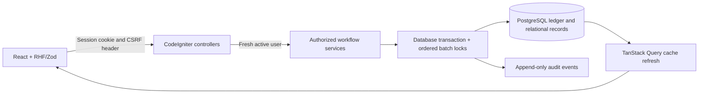
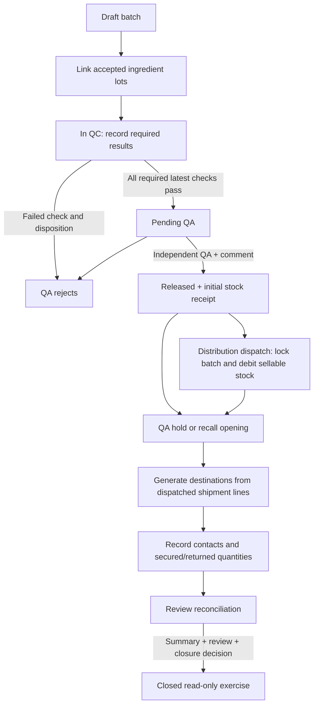
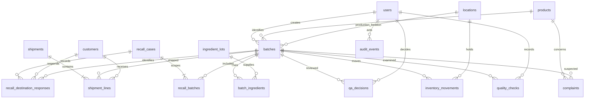

# Architecture and learning guide

## Request flow

Client validation gives quick feedback. It is not authorization. Every protected API request reads the active account from the database; mutation services check its role. An administrator has no QA permission by default. The independent-review check compares actor ID to the batch creator even if their role later changes.

`WorkflowService` holds batch transitions and shared transaction/audit/validation helpers. `InventoryService` controls ledger entries, warehouse actions and shipment dispatch/reversal. `RecallService` controls scope, destination responses, return movements and reconciliation. `TraceabilityService` assembles dossiers and ingredient-lot forward links. `Workspace` maps HTTP endpoints to services and reads; `Api` handles authentication. No controller decides stock availability or release eligibility.

## Workflows

Shipments can be saved as drafts without reserving/debiting stock. Dispatch rechecks batch, customer, location, expiry and available balance under a row lock. All lines are committed together; an insufficient second line rolls back the first. A dispatched shipment is corrected through a reversal movement and Cancelled status, never deletion. A held batch's shipments must be reconciled through recall rather than reversed.

Warehouse receipts cannot exceed produced stock already accounted for. Additional genuine quantity discrepancies use signed adjustments with a required reason. Quarantine transfers debit one location and credit another atomically. A stock hold also prevents shipment through non-sellable location checks. Recall holds block the entire batch.

All operations lock affected batches in ascending ID order. This serializes stock checks and recall opening, avoids check-then-write races, and reduces multi-batch deadlocks. PostgreSQL `FOR UPDATE` is the production path; SQLite tests acquire a write lock through a no-op row update.

## Quantity meanings

| Term | Calculation / meaning |
|---|---|
| Produced | Sum of scoped batch quantities |
| On hand | Signed movement sum across all locations, including quarantine and returned units |
| Gross shipped | Dispatched shipment-line quantities, excluding cancelled/reversed shipments |
| Secured | Latest confirmed physically segregated units still at a destination |
| Returned | Cumulative units physically returned to quarantine; increments create ledger receipts |
| Unresolved | Sum per destination of `max(0, shipped - secured - returned)` |
| Accounting difference | `produced - on_hand - (gross_shipped - returned)` |

Secured and returned are disjoint quantities. On hand already contains returns, so returned units must be deducted from gross shipped when reconciling physical stock. Exceptions beyond shipped quantity require a note and are retained; totals are never forced into balance. Every closure requires explicit review and a reconciliation comment, even when the accounting difference is zero. Closure can accept unresolved quantities for an educational exercise; it does not authorize a real recall conclusion.

## ER diagram

## Data dictionary

All tables have an integer primary key. Critical event timestamps are UTC `DATETIME` values; the frontend interprets them as UTC and renders browser-local time. Quantity fields are `DECIMAL(16,3)`. Foreign keys restrict destructive deletion. Catalogs have an active flag instead of a delete workflow.

| Table | Important fields / purpose |
|---|---|
| users | name, unique email, password_hash, role, active; role is constrained to six demo roles |
| products | unique code, name, dosage_form, active |
| customers | unique code, synthetic name/address/contact/phone, active |
| locations | unique code, name, type (Production, Sellable, Quarantine), active |
| ingredient_lots | unique code, material, supplier_lot, received_date, status, active |
| batches | unique code, product/creator/location FKs, production/expiry dates, quantity, status, notes |
| batch_ingredients | batch/ingredient FKs, quantity, unit; unique batch+lot relation |
| quality_checks | batch, name, required, result, notes, evidence_reference, analyst, time; append-only revisions |
| qa_decisions | batch, decision, required comment, actor, time; append-only |
| inventory_movements | batch/location, movement type, signed quantity, reference, reason, actor, time; append-only |
| shipments | unique reference, shipment_date, status, actor, created_at |
| shipment_lines | shipment/batch/customer/location FKs, quantity; destination stored per line |
| complaints | product/batch, source, description, demo severity, actor, time |
| recall_cases | reason, status, summary, reconciliation_comment, closure_decision, actor, start/close times |
| recall_batches | unique case+batch relation |
| recall_destination_responses | case/batch/customer, response status, secured/returned snapshots, note, actor, time; append-only |
| audit_events | actor, entity_type/id, action, JSON before_values/after_values, time; append-only |

Roles are stored as a constrained string on users, avoiding a separate role table for a fixed one-role-per-account demo. Catalog lookup indexes and composite indexes support batch/location balances, latest response/check lookup, audit entity history and date filtering. PostgreSQL checks enforce positive produced/ingredient/shipment quantities and valid expiry ordering. Services add workflow-specific constraints.

## Role permissions

All authenticated active roles can read operational history and synthetic reference catalogs. User account details are restricted to Admin.

| Action | Production | QC | QA | Warehouse | Distribution | Admin |
|---|---|---|---|---|---|---|
| Create draft / link ingredient / submit QC | Yes | — | — | — | — | — |
| Add checks / submit QA | — | Yes | — | — | — | — |
| Release / reject / batch hold | — | — | Yes | — | — | — |
| Receipt / transfer / quarantine / adjustment | — | — | — | Yes | — | — |
| Create / dispatch / reverse shipment | — | — | — | — | Yes | — |
| Record complaint / open/review/close recall | — | — | Yes | — | — | — |
| Contact / confirmation response | — | — | Yes | Yes | Yes | — |
| Change secured/returned quantities | — | — | — | Yes | — | — |
| Maintain catalogs / accounts | — | — | — | — | — | Yes |
| Modify/delete audit events | — | — | — | — | — | — |
